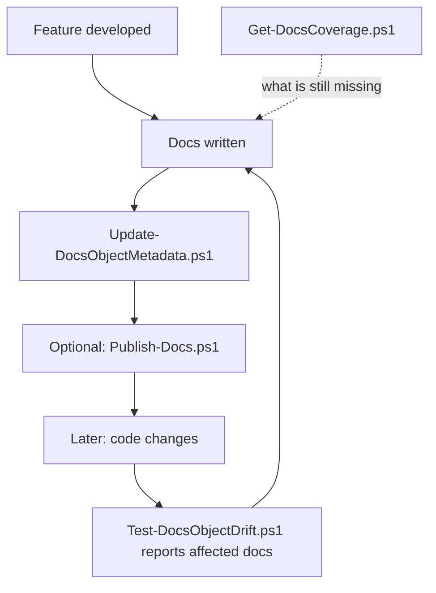

# Documentation Tooling

Three mechanisms keep the documentation in this repository honest. They are independent — use any
of them without the others. The procedures that use them live in the
[`bc-docs-feature`](../SKILL.md) skill (agent: `bc-doc`).

| Mechanism | Question it answers | Where |
|---|---|---|
| **Drift detection** | Has code changed that existing documentation describes? | [`documentation-drift.md`](documentation-drift.md), section 1 below |
| **Coverage** | What is not documented yet? | section 2 below |
| **Wiki.js sync** (optional) | Is the wiki up to date with the repository? | [`wikijs-publishing.md`](wikijs-publishing.md), section 3 below |

All scripts live in [`skills/bc-docs-feature/references/scripts/`](scripts/)
and run in Windows PowerShell 5.1 and PowerShell 7. Run them from anywhere inside the repository:

- **Repository root** — `-RepoRoot`, otherwise `git rev-parse --show-toplevel`.
- **AL sources** — every folder containing an `app.json` (e.g. `app/` and `test/`); objects are
  grouped into modules by app folder and first folder below `src/` (e.g. `app/Setup`).
- **Docs root** — `-DocsRoot`, otherwise `docs/` at the repository root.
- **Coverage policy** — `.github/docs-coverage-policy.json` if the project has one (copy the default
  and edit it — a project file survives template syncs), else the default
  [`docs-coverage-policy.json`](docs-coverage-policy.json) next to this file.

The examples below use `$s = './.github/skills/bc-docs-feature/references/scripts'`; adjust the path if
your project relocated its Copilot customizations.

---

## 1. Drift detection — has the code moved on without the docs?

The problem: someone changes codeunit 50103, and nobody remembers that
`docs/modules/sales/payment-tolerance/` describes exactly that codeunit.

Each documentation folder records, in a `metadata.json`, which AL objects it covers and what they
looked like when the documentation was last confirmed correct.

```powershell
# When the documentation is written or corrected
& "$s/Update-DocsObjectMetadata.ps1" `
    -DocFolder docs/modules/sales/payment-tolerance `
    -Object 'Codeunit 50103', 'Page 50101', 'Table Customer'

# Later: which documentation is now suspect?
& "$s/Test-DocsObjectDrift.ps1"
```

```text
  [outdated] docs/modules/sales/payment-tolerance
             - changed: codeunit 50103 ABC Payment Tolerance Mgt.
             - changed: tableextension 50102 Customer ABC Ext. (on Customer)
             What exactly changed:
             git diff 1a2b3c4d -- app/src/Codeunits/ABCPaymentToleranceMgt.Codeunit.al ...
```

Exit code `1` on drift, so it works as a pull-request check.

**Two rules that matter:**

1. **Always reference objects with their type.** `Codeunit 50103`, never `50103` — object IDs are
   unique per type, not globally (a table and a page may both be 50100). An untyped reference is
   rejected rather than guessed.
2. **Reference base objects by name to catch extensions.** `Table Customer` has no file in this repo,
   but recording it tracks every `tableextension` the app layers on it, and names the exact one that
   changed.

Details, limits and the metadata format:
[`documentation-drift.md`](documentation-drift.md).

---

## 2. Coverage — what is not documented yet?

```powershell
& "$s/Get-DocsCoverage.ps1"
```

```text
Documentation coverage
  documented        2
  open              3
  excluded          2   (by policy)

Module               Documented Open Excluded
app/Codeunits                 1    0        0
app/Setup                     1    2        0
...
```

| Want | Command |
|---|---|
| The open items of one module | `-Undocumented -Module app/Setup` |
| Only one object type | `-Undocumented -Type page` |
| **Only what changed recently** | `-Undocumented -ChangedSince main` |
| The excluded objects, with the reason | `-IncludeExcluded` |
| A machine-readable report | `-OutFile coverage.json` |

`-ChangedSince` is the most useful view for working through a backlog: it intersects the undocumented
objects with `git diff`, so you see what the team actually touched and never wrote up — instead of a
flat list of every object.

### Why coverage is not stored in a file

Coverage is **derived**: all objects, minus what documentation covers, minus what policy excludes.
The moment someone adds an object or writes a page, a stored coverage file would be wrong, so it is
recomputed on every run. For very large apps, use `Get-ALObjectIndex.ps1 -OutFile index.json` plus
`Get-DocsCoverage.ps1 -IndexFile index.json` if you explicitly want to trade freshness for speed.

Only two things are persisted, because they cannot be derived:

| File | Holds | Why it must be stored |
|---|---|---|
| `metadata.json` per doc folder | Which objects a documentation folder covers, and their hashes | A human decision plus a point-in-time snapshot |
| `.github/docs-coverage-policy.json` (default: [`docs-coverage-policy.json`](docs-coverage-policy.json)) | Which objects deliberately need no documentation | A human decision |

Without the policy file every report would list the same test, install and upgrade objects forever
and stop being read. Add a rule instead of ignoring the noise:

```json
{ "type": "codeunit", "namePattern": "*Install*", "reason": "Technical one-time run" }
```

A rule matches on `type`, `namePattern`, `filePattern` — or any combination — and needs a `reason`.

---

## 3. Wiki.js sync — repository to Wiki.js (optional)

Only relevant if your project mirrors its docs to a Wiki.js instance; skip it otherwise. The
repository is the single source; Wiki.js is the published copy. Front-matter (`wiki-path`,
`wiki-title`, `wiki-tags`) is the opt-in switch and never appears in the published page.

```powershell
# What is out of sync? Read-only, no URL or API key needed. Exit 0 = in sync, 1 = something to publish.
& "$s/Get-DocsSyncStatus.ps1"

# Preview, then publish changed pages (URL from WIKIJS_URL, key from WIKIJS_API_KEY or .env)
& "$s/Publish-Docs.ps1" -WhatIf
& "$s/Publish-Docs.ps1"
```

State lives in `docs/.wiki-sync.json` (committed). Configuration, manifest format, firewall
troubleshooting and CI examples:
[`wikijs-publishing.md`](wikijs-publishing.md).

---

## Typical rhythm



| Moment | Command |
|---|---|
| Docs written or corrected | `Update-DocsObjectMetadata.ps1 -DocFolder <folder>` |
| Before the pull request | `Test-DocsObjectDrift.ps1` |
| Before publishing (optional) | `Get-DocsSyncStatus.ps1` |
| Publishing (optional) | `Publish-Docs.ps1` |
| Planning the docs backlog | `Get-DocsCoverage.ps1 -Undocumented -ChangedSince main` |

---

## Script reference

| Script | Reads | Writes |
|---|---|---|
| `Get-ALObjectIndex.ps1` | AL sources | nothing (`-OutFile`: JSON index) |
| `Update-DocsObjectMetadata.ps1` | AL sources, doc folder | `metadata.json` in that folder |
| `Test-DocsObjectDrift.ps1` | AL sources, all `metadata.json` | nothing (exit code) |
| `Get-DocsCoverage.ps1` | AL sources, all `metadata.json`, policy, git | nothing (`-OutFile`: JSON report) |
| `Get-DocsSyncStatus.ps1` | docs, `.wiki-sync.json` | nothing (`-UpdateManifest`: status snapshot) |
| `Publish-Docs.ps1` | docs, `.wiki-sync.json` | Wiki.js, `.wiki-sync.json` |
| `upload-page.ps1` | one file or string | Wiki.js |

Shared logic sits in `DocsRepo.Common.ps1` (path resolution), `ALObjects.Common.ps1` (AL parsing and
hashing) and `DocsSync.Common.ps1` (wiki sync), so the checking and the writing scripts can never
compute a hash differently.

**Secrets:** the Wiki.js API key lives only in the environment variable `WIKIJS_API_KEY` or a
git-ignored `.env`. It is never passed on a command line and never committed.
