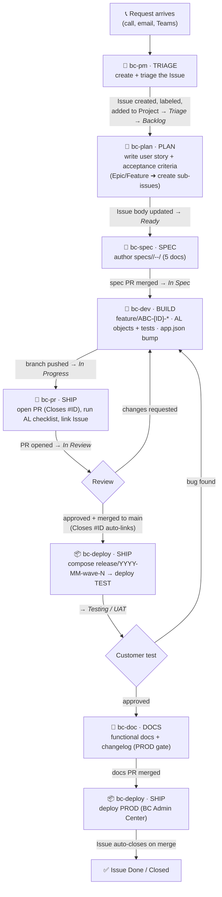
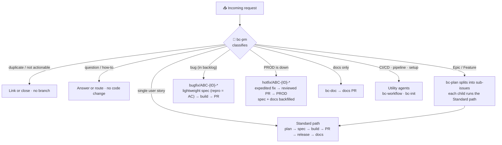

# BC ALM Template

> **A complete, opinionated Application Lifecycle Management template for Microsoft Dynamics 365 Business Central AL development teams.**

Combines spec-driven development, GitHub Copilot custom agents for every workflow stage, a documented branching strategy, and AL coding standards — all version-controlled in one place and ready to fork.

---

## What This Template Gives You

| Component | What it does |
|---|---|
| **10 Copilot agents** | Roles across the lifecycle — orchestrator, PM (triage), plan, spec, dev, PR, deploy, doc, plus CI/CD and setup utilities — routed via `handoffs:` |
| **Reusable skills** | [Copilot Agent Skills](.github/skills) — portable, trigger-fired procedures for each lifecycle phase (the "how" behind the agents) |
| **Prompt files** | Invokable onboarding tasks — [`/onboard-app`, `/generate-copilot-instructions`, `/onboarding-plan`](.github/prompts) — for onboarding projects and people |
| **Spec-driven development** | Structured spec folder per ticket: brief → plan → acceptance criteria → change log |
| **Branching strategy** | Documented model: `feature/*` from `main`, `release/*` composed selectively |
| **AL coding standards** | Always-on Copilot instructions applied to every `.al` file |
| **PR template** | BC-specific checklist: ADO link, affected objects table, quality gates |
| **Architecture docs** | [`WHEN-TO-USE.md`](.github/WHEN-TO-USE.md) decision map + [`AGENT-ARCHITECTURE.md`](.github/AGENT-ARCHITECTURE.md) design record |
| **AL agent tooling** | Pre-wired for Microsoft's [AL MCP & LSP servers + ALTool](docs/al-agent-tools.md) — agents build, compile, and navigate AL semantically (not by regex) |
| **BCQuality (optional)** | Hook Microsoft's [BCQuality](https://github.com/microsoft/BCQuality) review knowledge base into the AL quality gate ([docs](docs/bcquality.md)) |

---

## The Full BC Development Workflow

The same eight-stage lifecycle runs whether you track work in **Azure DevOps Boards** or in
**GitHub Issues + Projects** — only the work-item mechanics differ (the initializer wires exactly
one backend at Q7). Unsure which stage you're in? Give **`bc-orchestrator`** the ticket/issue
number and it routes you to the right agent. Full decision map:
[`.github/WHEN-TO-USE.md`](.github/WHEN-TO-USE.md).

### Backend: Azure DevOps Boards

```
ADO Ticket
    │
    ▼
[BC PM Agent] ──────► Ticket triaged + groomed
    │
    ▼
[BC Plan + BC Spec] ─► Spec Created (brief + plan + acceptance-criteria)
    │                  specs/<Area>/<type>-<ID>-<slug>/
    ▼
Spec PR Reviewed & Merged
    │
    ▼
[BC Dev Agent] ──────► Feature Branch: feature/ABC-{ID}-short-description
    │                  AL objects implemented, tests written
    ▼
[BC PR Agent] ───────► Pull Request opened
    │                  Description from spec + commits, checklist verified
    ▼
PR Reviewed & Merged to main
    │
    ▼
[BC Deploy Agent] ───► Release Branch: release/YYYY-MM-wave-N
    │                  Composed from selected feature merges
    ▼
Deployed to TEST environment
    │
    ▼
Customer Testing
    │
    ▼
Customer Approves
    │
    ▼
[BC Doc Agent] ──────► docs/functional/ABC-{ID}-title.md created
    │                  docs/changelog.md updated
    ▼
Documentation PR Reviewed & Merged
    │
    ▼
[BC Deploy Agent] ───► PROD Deployment via BC Admin Center API
    │
    ▼
ADO Ticket Closed ✅
```

### Backend: GitHub Issues & Projects

The flow below shows a single request travelling from a customer call to a closed issue — who
does what, which agent drives it, and how the **Issue** and its **Project board status** change at
each step. (Project statuses are illustrative — name your board columns however your team likes.)



**Which agent, step by step**

| # | You want to… | Switch to | What happens in GitHub | Issue / board status |
|---|---|---|---|---|
| 1 | Capture an incoming request | **bc-pm** | New **Issue** opened from the template, labeled, added to the Project | `Triage` |
| 2 | Triage, dedupe, prioritize, groom | **bc-pm** | Labels/priority set, duplicates linked, intake accepted | `Backlog` |
| 3 | Shape the user story + testable criteria | **bc-plan** | Issue **body** rewritten (story + AC). For an Epic/Feature, child **sub-issues** are created per story | `Ready` |
| 4 | Write the developer-ready spec | **bc-spec** | `specs/<Area>/<type>-<ID>-<slug>/` committed on a spec branch; spec **PR** opened & merged | `In Spec` |
| 5 | Implement the AL objects + tests | **bc-dev** | `feature/ABC-{ID}-*` branch; objects, tests, `app.json` version bump | `In Progress` |
| 6 | Open the pull request | **bc-pr** | **PR** with `Closes #ID`, AL quality checklist, work-item link | `In Review` |
| 7 | Handle review feedback | **bc-pr** / **bc-dev** | Changes-requested loops back to build; on merge the Issue auto-closes via `Closes #ID` | merged to `main` |
| 8 | Ship a release to TEST | **bc-deploy** | `release/YYYY-MM-wave-N` composed from selected merges; deployed to TEST | `Testing / UAT` |
| 9 | Write customer-facing docs (PROD gate) | **bc-doc** | `docs/functional/ABC-{ID}-*.md` + changelog; docs **PR** merged | — |
| 10 | Deploy to PROD | **bc-deploy** | PROD deploy via BC Admin Center | `Done` ✅ |

> **Tip — status automation:** if you use `Closes #ID` (or `Fixes #ID`) in the PR body, merging it
> **auto-closes** the linked Issue. Pair that with a GitHub **Projects** workflow ("Item closed → set
> status to Done", "PR opened → In Review") so board columns update themselves as the agents work.
> Sub-issues let an Epic/Feature (step 3) roll its children up automatically.

### Request types & routing (either backend)

Not every request is a fresh user story. **`bc-pm` classifies each incoming request first** and
sends it down the right path — the standard flow above is the backbone; the other cases branch off
it or short-circuit it. This routing is the same whether you track work in ADO or GitHub.



**Case cheat-sheet**

| Request type | bc-pm routes to | Path / branch | Spec? | Notes |
|---|---|---|---|---|
| **Single user story** | bc-plan | `feature/ABC-{ID}-*` · full lifecycle | ✅ full | The backbone diagram above. |
| **Epic / Feature** (multi-story) | bc-plan (breakdown) | parent issue + **sub-issues**; optional **integration branch** | ✅ per child | Each child runs the standard path; the parent closes when its children do. See [branching-strategy](docs/branching-strategy.md#optional-integration-branch-for-multi-story-features). |
| **Bug** (in backlog) | bc-plan → bc-spec | `bugfix/ABC-{ID}-*` | ✅ lightweight — repro steps become the acceptance criteria | Fix + a regression test; ships in the next wave. |
| **Hotfix** (PROD broken) | bc-dev (expedited) | `hotfix/ABC-{ID}-*` off the deployed release/tag → PROD, then forward-merge to `main` | ⏳ backfilled | The **only** path that may ship before the spec is written — but the PR + review gate is **never** skipped. |
| **Documentation only** | bc-doc | docs branch | — | `docs/functional/*` + changelog; no AL change. |
| **Duplicate / won't-do / question** | bc-pm | — | — | Label, link, close, or answer — no branch. |
| **CI/CD or pipeline change** | bc-workflow | utility (outside the lifecycle) | — | GitHub Actions / AL-Go pipelines. |
| **Template / repo setup** | bc-init | utility (one-time) | — | Adapt the template to your project. |

> **Spec-first, with one exception:** the template's rule is that AL work follows a reviewed spec —
> even a bug gets a *lightweight* spec (repro steps as acceptance criteria). A genuine **PROD-down
> hotfix** is the only case that may ship before the spec is written, and it still goes through a
> reviewed PR (see [branching-strategy.md](docs/branching-strategy.md)). The spec and functional docs
> are backfilled right after the fire is out.

---

## The 10 Copilot Agents

| Agent | Default model | What it does |
|---|---|---|
| **bc-orchestrator** | Claude Sonnet 4.6 | **Orchestrator.** Give it a ticket ID — it detects your current workflow stage and routes you to the right agent (via `handoffs:` and the `agent` tool). Start here. |
| **bc-pm** | Claude Sonnet 4.6 | **Project Manager.** Ticket intake, triage, prioritization and backlog grooming (ADO/GitHub). Gets work ready to plan. |
| **bc-plan** | Claude Sonnet 4.6 | **Planner.** Turns a triaged ticket into a crisp user story with testable acceptance criteria. |
| **bc-spec** | Claude Opus 4.8 | **Spec Author.** Writes the developer-ready 4-document spec folder from the user story. |
| **bc-dev** | Claude Sonnet 4.6 | **Developer.** AL implementation specialist. Reads the spec, guides object creation, enforces standards, generates test stubs. |
| **bc-pr** | Claude Opus 4.8 | **Pull Request.** Self-reviews, generates the PR description, runs the AL quality checklist, links the work item. |
| **bc-deploy** | Claude Sonnet 4.6 | **Deploy.** Manages release branches. Composes `release/wave-N` from selected features and guides TEST/PROD deployment. |
| **bc-doc** | Claude Sonnet 4.6 | **Documentation.** Reads specs and code. Generates customer-facing functional docs and changelog. Required gate before PROD. |
| **bc-workflow** | Claude Sonnet 4.6 | **Workflow Engineer (utility).** Authors and maintains CI/CD — GitHub Actions and AL-Go for GitHub pipelines. |
| **bc-init** | Claude Sonnet 4.6 | **Template Initializer (utility).** One-time guided setup that adapts this template to your project. |

All agents live in [`.github/agents/`](.github/agents/).

> **Note on models:** each agent sets a single `model:` that must match a name in your Copilot
> model picker. They are managed centrally in [`template.config.json`](template.config.json) under
> `models`. Defaults are **Claude Sonnet 4.6** for most agents and **Claude Opus 4.8** for the
> deep-reasoning ones (`bc-spec`, `bc-pr`). To change them, edit `template.config.json` and re-run
> the initializer (it rewrites each agent's `model:` line), or edit a `.agent.md` directly. If
> VS Code flags a model as unknown, add the ` (copilot)` suffix (e.g. `Claude Sonnet 4.6 (copilot)`).

Each agent is a thin persona backed by a **skill** that holds the actual procedure, and
declares **`handoffs:`** so you can step to the next phase in one click. `bc-workflow` and
`bc-init` are **utility** agents that sit outside the PLAN → DOCS lifecycle. See the
[architecture record](.github/AGENT-ARCHITECTURE.md).

---

## The Reusable Skills

[GitHub Copilot Agent Skills](https://docs.github.com/en/copilot/concepts/agents/about-agent-skills)
are portable `SKILL.md` procedures that fire automatically when your request matches their
`Use when:` triggers — in chat, the CLI, or from an agent. They are the single source of truth
for *how* each phase is done, so agents and skills never drift apart.

| Skill | Phase | Purpose |
|---|---|---|
| [`bc-triage-backlog`](.github/skills/bc-triage-backlog/SKILL.md) | TRIAGE | Intake, triage, prioritize and groom work items (ADO/GitHub) |
| [`bc-plan-user-story`](.github/skills/bc-plan-user-story/SKILL.md) | PLAN | Ticket → user story + acceptance criteria |
| [`bc-spec-author`](.github/skills/bc-spec-author/SKILL.md) | SPEC | Author the 4-document spec folder |
| [`bc-build-feature`](.github/skills/bc-build-feature/SKILL.md) | BUILD | Implement AL objects to spec + standards + tests |
| [`bc-review-self`](.github/skills/bc-review-self/SKILL.md) | REVIEW | Pre-PR self-review against the AL quality gate |
| [`bc-ship-pull-request`](.github/skills/bc-ship-pull-request/SKILL.md) | SHIP | Compose the PR description + checklist + ADO link |
| [`bc-ship-release`](.github/skills/bc-ship-release/SKILL.md) | SHIP | Compose a release branch, deploy TEST/PROD |
| [`bc-docs-feature`](.github/skills/bc-docs-feature/SKILL.md) | DOCS | Customer-facing functional docs + changelog |
| [`bc-cicd-pipeline`](.github/skills/bc-cicd-pipeline/SKILL.md) | CI/CD | Author/maintain GitHub Actions & AL-Go for GitHub pipelines |
| [`bc-util-commit-message`](.github/skills/bc-util-commit-message/SKILL.md) | util | Conventional commits with ADO work-item linking |

See [`.github/SKILLS.md`](.github/SKILLS.md) for the index and
[`.github/WHEN-TO-USE.md`](.github/WHEN-TO-USE.md) for a decision map of agents vs skills.

> **Coexistence with plugin skills.** Copilot discovers skills from every active source at once —
> this repo's `.github/skills/`, your personal skills, and any **enabled plugin** (e.g. a
> marketplace plugin shipping fine-grained `al-*` skills). A skill fires when your request matches
> its `Use when:` triggers, no matter where it lives. These template skills (`bc-*`, lifecycle
> procedures) are deliberately **self-contained** and use a distinct prefix, so they don't collide
> with or override plugin skills — the two stack: `bc-*` drives *what* to do per phase, your
> `al-*` plugin skills inform *how* the AL should look. Keep trigger phrases distinct to avoid
> loading redundant context.

---

## The Prompt Files

[Prompt files](https://docs.github.com/en/copilot/concepts/prompting/response-customization#about-prompt-files)
(`.github/prompts/*.prompt.md`) are **explicitly-invoked, parameterized tasks** — the third
customization type alongside agents (personas) and skills (auto-firing procedures). Run one in
VS Code Copilot Chat by typing `/` and the file name; it prompts you for any inputs it declares.

| Prompt | Invoke | Purpose |
|---|---|---|
| [`onboard-app`](.github/prompts/onboard-app.prompt.md) | `/onboard-app` | Bring a new/existing AL app under the template: capture the ALM decisions, apply them via the initializer, scaffold instructions + the first spec |
| [`generate-copilot-instructions`](.github/prompts/generate-copilot-instructions.prompt.md) | `/generate-copilot-instructions` | Analyze the codebase and write/refresh `.github/copilot-instructions.md` + path-scoped `.github/instructions/*.instructions.md` |
| [`onboarding-plan`](.github/prompts/onboarding-plan.prompt.md) | `/onboarding-plan` | Build a phased, personalized onboarding plan for a new team member |

See [`.github/prompts/README.md`](.github/prompts/README.md) for details and how to add your own.

---

## Spec-Driven Development

Every ticket gets its own spec folder before a single line of AL is written:

```
specs/
└── ABC-123-payment-tolerance/
    ├── brief.md              ← Customer request in plain language
    ├── plan.md               ← Technical approach, affected AL objects
    ├── acceptance-criteria.md ← Given/When/Then criteria, edge cases
    └── change-log.md         ← Version history of the spec
```

**Why in the repo?**
- Specs are version-controlled alongside the code they describe
- Agents read spec files by convention — `bc-dev` reads your plan, `bc-doc` reads your acceptance criteria
- Specs become the source of truth for PR descriptions, functional docs, and customer sign-off
- Easy to review: spec PR is separate from code PR

Start from the template: [`specs/_TEMPLATE/`](specs/_TEMPLATE/)

See the full explanation: [docs/spec-driven-development.md](docs/spec-driven-development.md)

---

## Branching Strategy (Summary)

```
main  ◄──────────────────────── PROD environment (protected)
  │
  ├── feature/ABC-123-payment-tolerance   ◄── DEV (one per ticket)
  ├── feature/ABC-124-vat-report-fix      ◄── DEV
  │
  └── release/2025-06-wave-1              ◄── TEST (composed selectively)
        = merge of ABC-123 + ABC-124
```

**Key decisions:**
- Feature branches are cut from `main` (not from a `develop` branch)
- Release branches are composed by cherry-picking or merging specific feature branches — not all of them
- This solves the "selective deployment" problem: you can ship ABC-123 without shipping ABC-124 if it isn't ready
- `main` is always production-ready and protected

Full documentation: [docs/branching-strategy.md](docs/branching-strategy.md)

---

## Getting Started

### 1. Use this template

Click **"Use this template" → "Create a new repository"** (top of the repo page) to create
your own copy. Don't clone directly — the template structure is what you're copying.

> **Maintainers:** for the "Use this template" button to appear, enable it once in
> **Settings → General → Template repository**. Also consider protecting `main`
> (Settings → Branches) since the workflow assumes `main` is production-ready.

### 1a. Or: use the BC ALM VS Code extension

Prefer clicking over scripts? The **BC ALM** extension ([`vscode-extension/`](vscode-extension/))
wraps everything below in VS Code:

- **New Project from Template…** / **Add BC ALM to This Repository…** guide you through prefix,
  range, repo, work-item system and content categories, then run the scripts for you.
- A **Components** view shows every agent, skill, prompt, instruction and workflow with its
  status (up to date, update available, conflict, modified, custom, disabled). You can update,
  3-way merge, keep your version, disable, or install individual components.
- **Save to My Template…** pushes your customizations to your own template repository
  (overwrite or save as new; direct commit or PR). **Contribute to Source Template** opens a PR
  upstream.
- **Several templates**: this repository is a template catalog — the root `bc-alm` template plus
  [`.templates/<id>/`](.templates/README.md) templates and variants (e.g. `bc-alm-lite`). Browse
  and pick templates, add your own via pull request, create variants and follow released versions.
- A **Guidance & What's New** view shows best practices, template changes and Copilot updates.
  Live validation flags outdated agent/skill/prompt frontmatter.

Install **BC ALM** from the
[Visual Studio Marketplace](https://marketplace.visualstudio.com/items?itemName=AlexanderErdelyi.bc-alm),
or run `code --install-extension AlexanderErdelyi.bc-alm`. The VSIX is also attached to each
[release](https://github.com/AlexanderErdelyi/bc-alm-template/releases) (`ext-v*` tags). Full
guide: [docs/vscode-extension.md](docs/vscode-extension.md).

### 1b. Or: add the template to an existing repo

Already have a BC repo? Overlay the template instead of starting fresh — **no clone required**.
It's a **two-step flow**: first choose *where* the Copilot customizations live and *which* content
categories you want, then execute the copy. Run both from the root of your existing repo:

```powershell
$b = irm https://raw.githubusercontent.com/AlexanderErdelyi/bc-alm-template/main/bootstrap.ps1
# 1. Configure — answer a few prompts; writes template.config.json, copies nothing:
& ([scriptblock]::Create($b)) -Configure -Interactive
# 2. Execute — copies core + the categories you enabled (-WhatIf to preview first):
& ([scriptblock]::Create($b)) -WhatIf
& ([scriptblock]::Create($b))
```

Prefer flags over prompts (or a one-shot with the lean defaults)? Everything is a switch:

```powershell
# One-shot, customizations under app/, also pull the docs/ library:
& ([scriptblock]::Create($b)) -CustomizationsPath app -IncludeReferenceDocs
```

Prefer to see the files first? Clone the template and run the overlay installer directly — same
`-Configure` / execute split:

```powershell
pwsh ./scripts/Install-IntoExistingRepo.ps1 -TargetRepo C:\path\to\your-repo -Configure -Interactive
pwsh ./scripts/Install-IntoExistingRepo.ps1 -TargetRepo C:\path\to\your-repo -WhatIf   # then drop -WhatIf
```

**You pick what gets copied.** Only the *core* — agents, skills, instructions,
`copilot-instructions.md`, `template.config.json`, and the sync workflow + scripts — is always
installed. Everything else is an opt-in/opt-out **content category**, and your choice is saved to
`template.config.json` (`sync.include`) so later syncs honor it and never re-add what you excluded:

| Category | Flag | Default (existing repo) |
| --- | --- | --- |
| Agent meta-docs (`AGENT-ARCHITECTURE` / `WHEN-TO-USE` / `SKILLS.md`) | `-IncludeMetaDocs` | off |
| Reference docs (`docs/`: bcquality, branching, workflow, …) | `-IncludeReferenceDocs` | off |
| Issue-ops pipeline (`issue-*.yml` + `ISSUE_TEMPLATE` + `ISSUE_ORCHESTRATION.md`) | `-IncludeIssueOps` | off |
| Spec scaffold (`specs/_TEMPLATE`) | `-NoSpecs` to drop | on |
| PR template (`PULL_REQUEST_TEMPLATE.md`) | `-NoPrTemplate` to drop | on |
| Sample AL app (`app/` + `test/` + workspace) | `-IncludeSampleApp` | off |
| GitHub Actions template-sync (`template-sync.yml` + `.templatesyncignore`) | `-NoSyncWorkflow` to drop | on (auto-off for ADO) |

It **never clobbers your existing files**: new paths are added (anything you already have is skipped
— `-Force` overwrites); merge-sensitive files (`.github/copilot-instructions.md`,
`PULL_REQUEST_TEMPLATE.md`, `.vscode/*`, `.gitignore`) are written next to yours with a `.template`
suffix so you can diff and merge by hand.

**Azure DevOps-only repo?** The GitHub Actions template-sync workflow (`.github/workflows/template-sync.yml`
+ `.templatesyncignore`) never runs there, so the installer **auto-skips it** when it sees ADO markers
(`.devops`/`.azuredevops`/`azure-pipelines.yml`) and no existing `.github/workflows` — no dead root
`.github/` is created. Pass `-NoSyncWorkflow` to force it off anywhere. Ongoing template updates then
run via `pwsh ./.bc-alm/scripts/Update-FromTemplate.ps1` (or an ADO pipeline) instead. Also turn off the
issue-ops pipeline (it's off by default) and keep work-item links on `AB#` by initializing with
`workItemSystem=ADO`.

**Keep the customizations in your app folder instead of the repo root?** Pass
`-CustomizationsPath app` (or any subfolder) — or just let the installer **auto-detect** it: if your
repo already keeps its Copilot files under a subfolder (e.g. `app/.github/agents`), that layout is
recognized and reused without a flag. The agents, skills, instructions, `copilot-instructions.md`,
and the agent meta-docs (`AGENT-ARCHITECTURE.md` / `WHEN-TO-USE.md` / `SKILLS.md`) are placed under
`app/.github/`, the spec scaffold under `app/specs/`, and the editor configs under `app/.vscode/`
(so `launch.json` / `tasks.json` / `mcp.json` / `extensions.json` apply when you open that folder) —
handy when you open a subfolder directly in VS Code — while the GitHub platform files (workflows,
issue/PR templates) always stay at the repo root,
because GitHub Actions and
Copilot on github.com only read the root `.github/`. The choice is recorded in `template.config.json`
(`sync.customizationsPath`) so later syncs keep writing to the same place.

**The template's own bookkeeping lives in `.bc-alm/`.** The overlay keeps your repo root clean:
`template.config.json`, `template.lock.json`, `PROJECT.md`, `.templatesyncignore` and the
template scripts (`Initialize-Template.ps1`, `Update-FromTemplate.ps1`, …) go into a single
`.bc-alm/` folder instead of the root and `scripts/`. The agents, skills, instructions and
workflows stay where Copilot and GitHub expect them. Projects created earlier with the root layout
are moved into `.bc-alm/` automatically by the next `Update-FromTemplate.ps1` run (or the
extension's **Move BC ALM Files into .bc-alm/** command). Pass `-ClassicLayout` to keep the old
layout.

Then continue with step 2 (run the initializer) inside your repo:
`pwsh ./.bc-alm/scripts/Initialize-Template.ps1 -ExistingRepo -Interactive`. The overlay also drops
in `.bc-alm/.templatesyncignore` and `.bc-alm/scripts/Update-FromTemplate.ps1` so you can
[pull later template updates](#7-keep-in-sync-with-the-template) the same way.

### 2. Initialize the template for your project

Run the guided initializer to replace the sample prefix, object ID range, publisher, repo slug,
and work-item style with your own. Easiest in VS Code: **Terminal → Run Task… → "BC: Initialize
project (guided)"** — a form-style wizard pops a text box for each value (type, press Enter to
advance). You can also use the **`bc-init`** Copilot agent or
`./scripts/Initialize-Template.ps1 -Interactive`. See
[Customizing This Template](#customizing-this-template) for details. Do this once, before your
first feature.

> **Cleanup & content pruning:** when you ran the guided wizard from a repo **created via "Use this
> template"**, the initializer replaces this template's `README.md` with a short project README,
> removes template-only files (`CONTRIBUTING.md`, `bootstrap.ps1`,
> `scripts/Install-IntoExistingRepo.ps1`), and — with the **Content profile** set to *Lean*
> (default) — **prunes content a working project doesn't need**. GitHub's "Use this template" copies
> the *whole* tree, so this is where a new repo gets slimmed down. Lean drops the agent authoring
> meta-docs (`AGENT-ARCHITECTURE.md`, `WHEN-TO-USE.md`, `SKILLS.md`) and keeps the `docs/` library,
> issue-ops pipeline, spec scaffold, PR template and the sample AL app. The choice is written to
> `template.config.json` (`values.sync.include`) so later [template syncs](#7-staying-in-sync-with-the-template)
> never re-add what you pruned.
>
> For finer control, run the initializer directly and mix in category switches:
>
> ```powershell
> # keep everything (no pruning):
> ./scripts/Initialize-Template.ps1 -CleanupTemplateFiles -Prune:$false
> # lean, and also drop the docs library, issue-ops pipeline and the sample app:
> ./scripts/Initialize-Template.ps1 -CleanupTemplateFiles -NoReferenceDocs -NoIssueOps -NoSampleApp
> # keep the meta-docs after all:
> ./scripts/Initialize-Template.ps1 -CleanupTemplateFiles -IncludeMetaDocs
> ```
>
> Category flags: `-IncludeMetaDocs` (kept off by default) and `-NoReferenceDocs` / `-NoIssueOps` /
> `-NoSpecs` / `-NoPrTemplate` / `-NoSampleApp` (each kept on by default). `-Interactive` prompts for
> every category. Pruning is skipped automatically when run inside the template repo itself.

### 3. Copy the spec template for your first ticket

```bash
cp -r specs/_TEMPLATE/_area specs/Finance
cp -r specs/_TEMPLATE/_story specs/Finance/us-123-your-feature-name
```

Fill in `brief.md` first, then open a spec PR before writing any AL code.

### 4. Install the recommended AL extensions

When you open the repo in VS Code, it will prompt you to install the recommended extensions
from [`.vscode/extensions.json`](.vscode/extensions.json) — the AL Language extension plus the
team toolchain (Object ID Ninja, AL Test Runner, CRS, NAB AL Tools, GitLens, Docker). Accept the
prompt, or run **Extensions: Show Recommended Extensions** from the Command Palette.

### 5. Configure ADO MCP (optional but recommended)

Edit [`.vscode/mcp.json`](.vscode/mcp.json) with your Azure DevOps organization and project. This lets the `bc-pm` and `bc-orchestrator` agents read your ADO tickets directly.

### 6. Use the agents

Open GitHub Copilot Chat in VS Code or GitHub.com and select an agent from the dropdown:

- **Not sure where to start?** → `BC Orchestrator` — give it a ticket ID
- **New ticket to triage?** → `BC PM` — intake, triage, and groom the backlog
- **Need a spec?** → `BC Plan` (user story) then `BC Spec` — give it an ADO ticket ID or paste the description
- **Implementing?** → `BC Developer` — tell it to work on `specs/Finance/us-123-payment-tolerance/`
- **Ready to ship?** → `BC PR` → `BC Deploy` → `BC Doc` → `BC Deploy`

> **Agents not showing in the Copilot dropdown?** VS Code discovers `.github/agents`,
> `skills`, `prompts`, and `instructions` per *workspace-folder root*. Two situations hide them:
> - **You opened the `*.code-workspace`.** Its roots are the `app/` and `test/` projects, so the
>   repo-level `.github/` folder sits *above* them. The shipped
>   `bc-alm-template.code-workspace` already sets
>   **`"chat.useCustomizationsInParentRepositories": true`** so VS Code walks up to the repo root
>   and finds them.
> - **You opened a subfolder (e.g. `app/`) directly.** The workspace-file setting doesn't apply,
>   so enable the same discovery in your **VS Code User settings** — once, and it works however you
>   open folders:
>   ```powershell
>   pwsh ./scripts/Enable-CopilotCustomizations.ps1 -Scope User
>   ```
>   (or run the **"BC: Enable Copilot customizations (User settings)"** task, or open the repo root
>   as a folder). This only sets a discovery flag — the `bc-*` agents keep living in each repo.
>
> None of this affects **GitHub Actions / Copilot on github.com**: they always read the repo's
> committed `.github/` files directly, regardless of any local VS Code setting.

### 6b. Onboard people and new projects (prompt files)

Three [prompt files](.github/prompts/README.md) turn onboarding into one-line commands in VS Code
Copilot Chat:

- **New app or project?** Run **`/onboard-app`** — it reads the current `app.json`/config, asks you
  for the prefix, object-ID range, publisher, BC version, work-item system and branching/commit
  conventions, then applies them with the initializer and scaffolds your instructions and first spec.
- **Need repository instructions?** Run **`/generate-copilot-instructions`** — it analyzes the code
  and writes/refreshes `.github/copilot-instructions.md` plus path-scoped
  [`.github/instructions/*.instructions.md`](https://docs.github.com/en/copilot/how-tos/configure-custom-instructions/add-repository-instructions)
  so Copilot is grounded in *your* conventions.
- **New team member?** Hand them **`/onboarding-plan`** — a phased, personalized ramp-up plan
  grounded in this repo.

### 7. Keep in sync with the template

The repo you created stays connected to the template so you can pull improvements later — new
agents, sharper instructions, script fixes — **without touching your own code**. Two ways:

```powershell
# On demand, from your machine — refreshes only template-managed files, commits nothing:
pwsh ./scripts/Update-FromTemplate.ps1 -WhatIf   # preview, then drop -WhatIf
# review 'git diff', then commit what you want
```

Or let it come to you as a pull request: [`.github/workflows/template-sync.yml`](.github/workflows/template-sync.yml)
runs `Update-FromTemplate.ps1` weekly — and on demand from the **Actions** tab — then opens a PR
(via [`create-pull-request`](https://github.com/peter-evans/create-pull-request)) with the latest
template changes. Review and merge it. Because the Action runs the same script, it honors every
`sync` setting below identically to a local run.

Both respect [`.templatesyncignore`](.templatesyncignore): your AL source (`app/`, `test/`), your
specs, `PROJECT.md`, `template.config.json`, `copilot-instructions.md`, and the token-injected
`.vscode` files are **never overwritten**. Everything else (agents, skills, instructions,
workflows, meta-docs, scripts) is template-managed and gets refreshed.

#### Control what sync touches

Sync is driven by the `sync` block in [`template.config.json`](template.config.json), so you keep
your local customizations even as you pull template improvements:

```jsonc
"sync": {
  "customizationsPath": ".",   // where your agents/skills/instructions live ("." = root, or e.g. "app")
  "syncWorkflow": true,         // false = skip the GitHub Actions template-sync (auto-off for ADO repos)
  "updateModels": false,        // false = re-apply your agent model choices after refreshing the file
  "updateExtensions": false,    // false = keep your .vscode/extensions.json (your toolset)
  "updateInstructions": true,   // false = keep your .github/instructions untouched
  "include": {                  // per-category switches — off = never copied or re-added
    "metaDocs": true,           // .github/AGENT-ARCHITECTURE.md, WHEN-TO-USE.md, SKILLS.md
    "referenceDocs": true,      // the docs/ library
    "issueOps": true,           // issue-*.yml + ISSUE_TEMPLATE + ISSUE_ORCHESTRATION.md
    "specs": true,              // specs/_TEMPLATE scaffold
    "prTemplate": true,         // .github/PULL_REQUEST_TEMPLATE.md
    "sampleApp": false          // demo app/ + test/ (install-time only)
  },
  "components": {               // per-component policy (ids: agent:<name>, skill:<folder>, prompt:<name>, …)
    "disabled": [],             // never installed or re-added
    "keepLocal": []             // never overwritten; you own these
  }
}
```

| Key | Default | What it does |
| --- | --- | --- |
| `customizationsPath` | `.` | Folder holding `.github/agents`, `.github/skills`, `.github/instructions`, and `copilot-instructions.md`. Set to `app` (or any subfolder) to relocate them; platform files stay at the repo root either way. |
| `syncWorkflow` | `true` | When `true`, the GitHub Actions template-sync workflow (`.github/workflows/template-sync.yml` + `.templatesyncignore`) is installed and kept refreshed. Set `false` (auto-defaulted for Azure DevOps-only repos) to skip it and sync manually via `scripts/Update-FromTemplate.ps1`. |
| `updateModels` | `false` | When `false`, sync refreshes each agent's prompt/handoffs **but re-applies your `model:`** from `template.config.json` afterward, so a template change never resets your model picks. Set `true` to also adopt the template's models. |
| `updateExtensions` | `false` | When `false`, your [`.vscode/extensions.json`](.vscode/extensions.json) is left alone — change your toolchain freely without sync reverting it. Set `true` to track the template's recommended extensions. |
| `updateInstructions` | `true` | When `false`, `.github/instructions` (your AL coding standards) is not refreshed. |
| `include.*` | see above | Per-category on/off switches for optional content (meta-docs, `docs/`, issue-ops pipeline, specs scaffold, PR template, sample app). A category set to `false` is **never copied by the installer and never re-added by sync** — so a repo that opted out of, say, the docs library or the GitHub issue-ops pipeline stays lean. The template ships them all on; `Install-IntoExistingRepo.ps1` writes a leaner profile (meta-docs / docs / issue-ops / sample app off) that you pick during its `-Configure` step. |

| `components.disabled` | `[]` | Component ids (e.g. `agent:bc-deploy`, `skill:bc-ship-release`, `workflow:issue-planning`) that are never installed or re-added. The VS Code extension moves disabled files to `.bc-alm/disabled/`. |
| `components.keepLocal` | `[]` | Component ids that sync never overwrites, so you own them. The extension still shows when upstream changed them. |

The values map (`models` in `template.config.json`) is the single source of truth for `updateModels: false`
re-application — update a model there once and every sync keeps it.

#### Your edits survive updates (`template.lock.json`)

Sync records a baseline in `template.lock.json`: for every synced file, the template commit and a
hash of what was installed. On the next sync, a file that still matches its hash is updated.
A file **you edited** is kept and listed instead of overwritten. Use `-OverwriteLocalChanges`
to take the template version anyway, or use the VS Code extension for a 3-way merge. Files
removed upstream are reported, never deleted. Commit the lock so the template-sync Action and
your teammates share the same baseline.

#### Keep your own tools across syncs (`extraTools`)

Agent and prompt files are template-owned, so their `tools:` lists get overwritten on every sync.
If your team relies on extra tool IDs that aren't in the template's default lists (custom MCP
servers, local AL tooling, etc.), record them in `values.extraTools` and both the initializer and
`Update-FromTemplate.ps1` will **re-append them after each refresh** (additive only — never removed):

```jsonc
"extraTools": {
  "all":     ["bc-code-intel/*"],           // added to every agent + prompt
  "agents":  { "bc-dev": ["nab-al-tools/*"] }, // added only to .github/agents/bc-dev.agent.md
  "prompts": { "onboard-app": ["prism/*"] }    // added only to .github/prompts/onboard-app.prompt.md
}
```

Per-file keys are the filename without the `.agent`/`.prompt` suffix. The initializer's
`-ExtraTools` parameter (or its interactive prompt) seeds `extraTools.all`. Keep **machine-specific**
server IDs out of shared config — set those in your VS Code tool picker instead.

This template includes a small, working AL extension so you can see the conventions applied
to real code (and have something that compiles from day one). It is structured as a
**two-project workspace** — a production app and a separate test app — the same layout
AL-Go for GitHub uses:

```
app/                         ← Production app (compiles to the shipped extension)
├── app.json                 ← Manifest: publisher ABC, object range 50100–50199
└── src/
    ├── Setup/               ← "ABC Payment Setup" table + setup card page
    ├── TableExtensions/     ← "Customer ABC Ext." adds a Payment Tolerance % field
    ├── Codeunits/           ← "ABC Payment Tolerance Mgt." business logic
    └── Permissions/         ← "ABC Payment" permission set
test/                        ← Separate test app (depends on app/ + Microsoft test libs)
├── app.json                 ← Test manifest: Library Assert / Any dependencies
└── src/                     ← GIVEN/WHEN/THEN test codeunit (see test/README.md)
bc-alm-template.code-workspace  ← Multi-root workspace tying app/ + test/ together
.vscode/                     ← AL launch + analyzer settings
```

It's the same "Payment Tolerance" example used throughout the
[AL coding standards](.github/instructions/al-coding-standards.instructions.md), so the docs
and the code stay in sync. Delete it (and keep just the structure) once you start your own
feature, or use it as a reference.

> **Target version** — the sample is pinned to **BC 2026 wave 1 (v28, runtime 16.0)** and is
> verified to compile clean (production + tests) against symbols from the public Microsoft
> symbols feed. To retarget a different release, edit `values.bcVersion` in
> [`template.config.json`](template.config.json) and re-run the initializer — it rewrites
> `application`/`platform`/`runtime` in both `app/app.json` and `test/app.json`. See
> [docs/al-agent-tools.md](docs/al-agent-tools.md#symbols--building-from-the-cli-no-docker--no-online-sandbox)
> for headless symbol download + CLI build steps.

> Need a full CI/CD build, test, signing, and deployment pipeline? See
> [docs/al-go-upgrade.md](docs/al-go-upgrade.md) for an optional upgrade path to
> **AL-Go for GitHub**.

---

## AL Agent Tools — MCP & LSP

Microsoft ships first-party tooling that lets AI agents (including GitHub Copilot) **build,
compile, publish, and navigate** AL code reliably instead of guessing from text. This template
is pre-wired for it. Full guide: **[docs/al-agent-tools.md](docs/al-agent-tools.md)**.

| Surface | What it gives an agent | How it's enabled here |
|---|---|---|
| **AL MCP Server** ([`launchmcpserver`](https://learn.microsoft.com/en-us/dynamics365/business-central/dev-itpro/developer/devenv-al-tool#almcp)) | `al_build`, `al_compile`, `al_getdiagnostics`, `al_symbolsearch`, `al_downloadsymbols`, … over stdio | Ready-to-enable entry in [`.vscode/mcp.json`](.vscode/mcp.json) (disabled key `_al` → rename to `al`) |
| **AL LSP Server** ([`launchlspserver`](https://learn.microsoft.com/en-us/dynamics365/business-central/dev-itpro/developer/devenv-al-tool#al-lsp)) | Semantic go-to-definition, find-references (cross-project), rename, type hierarchy — follows `internalsVisibleTo` / `propagateDependencies` instead of regex | Spawned by your agent/editor as a child process; repo-specific launch command + config in [docs](docs/al-agent-tools.md#2b-enable-the-al-lsp-server-for-agents) |
| **ALTool CLI** ([`al` / ALTool](https://learn.microsoft.com/en-us/dynamics365/business-central/dev-itpro/developer/devenv-al-tool)) | `al workspace compile`, `al compile`, headless symbol fetch + build | `dotnet tool install --global Microsoft.Dynamics.BusinessCentral.Development.Tools`; works against the shipped `bc-alm-template.code-workspace` |

> **Enabling the AL LSP server (verified).** `launchlspserver` is newer than the MCP server and
> currently ships **only in prerelease ALTool builds** — confirmed working on **`18.0.37-beta`**
> (the latest *stable* channel is `17.x`, which does not have it). Install/update with the
> `--prerelease` flag, then confirm the verb is listed:
>
> ```powershell
> dotnet tool update --global Microsoft.Dynamics.BusinessCentral.Development.Tools --prerelease
> al --help        # 'launchlspserver' should appear in the command list
> pwsh ./scripts/Start-ALLanguageServer.ps1   # interactive smoke-test (Ctrl+C to stop)
> ```
>
> Smoke-tested against this repo's `app/` + `test/`: both projects load as one cross-project
> component and the server registers 24 LSP endpoints (definition, references, rename, type
> hierarchy, `workspace/symbol`, hover, completion, …). **Note:** an LSP *host* must spawn
> `al launchlspserver` **directly** — don't route the JSON-RPC stream through a shell wrapper,
> which corrupts the binary framing. The wrapper script prints the exact direct command (to
> stderr) to copy into your host config. See
> [docs/al-agent-tools.md](docs/al-agent-tools.md#2b-enable-the-al-lsp-server-for-agents).

---

## BCQuality — Microsoft's AL Review Knowledge Base (optional)

[**microsoft/BCQuality**](https://github.com/microsoft/BCQuality) is an MIT-licensed, machine-
readable catalog of Business Central quality rules and review guidance maintained by Microsoft
and the BC community. This template can wire it into the `bc-review-self` quality gate so AL
findings cite a Microsoft-/community-vetted rule instead of an opinion.

```powershell
./scripts/Add-BCQuality.ps1            # vendor a tracked copy (or -Mode submodule)
```

Or opt in during the guided **`bc-init`** setup. See **[docs/bcquality.md](docs/bcquality.md)**
for how reviews consume it and how to keep the copy up to date.

---

## Customizing This Template

After creating your repo from the template, run the **guided initializer** — it replaces the
prefix, object ID range, publisher, repo slug, ADO org, and work-item style across the whole repo
(and renames the sample AL files) in one pass.

**Option A — VS Code task (form-style wizard, recommended):** **Terminal → Run Task… → "BC:
Initialize project (guided)"**. VS Code shows a text box at the top of the window for each value
in turn — type your answer (or accept the shown default) and press Enter to advance; the last
field runs the initializer. Run **"BC: Initialize project (preview / -WhatIf)"** first to see the
changes without writing anything. (Defined in [`.vscode/tasks.json`](.vscode/tasks.json).)

**Option B — Copilot agent (conversational):** open Copilot Chat and select the **`BC Template
Initializer`** (`bc-init`) agent. It offers the task above, or interviews you in chat, previews
the changes, then applies them.

**Option C — PowerShell script:** run it interactively, or pass values for CI:

```powershell
# Interactive — prompts for each value (Enter accepts the default)
./scripts/Initialize-Template.ps1 -Interactive

# Preview a non-interactive run without writing anything
./scripts/Initialize-Template.ps1 -AppPrefix XYZ -TicketPrefix PROJ `
  -ObjectIdFrom 60000 -ObjectIdTo 60099 -Publisher "Contoso Ltd." `
  -AppName "Contoso Payment Tolerance" -RepoSlug "contoso/bc-app" `
  -AdoOrg contoso -WorkItemSystem GitHub -WhatIf
```

The values it manages live in [`template.config.json`](template.config.json); after a run it
records your choices there and generates a `PROJECT.md` summary. The tokens it replaces:

| Placeholder | What it is | Replace with | Where |
|---|---|---|---|
| `ABC` | App / object name prefix | Your assigned BC partner prefix | `app/app.json`, `app/src/**`, `test/**`, instructions, agents, docs |
| `50100`–`50199` | Object ID range | Your assigned object ID range | `app/app.json` & `test/app.json` (`idRanges`), `app/src/**`, `test/src/**`, `.vscode/launch.json` |
| `ABC-{ID}` / `AB#` | Ticket reference style | Your ADO project key (or GitHub `#`) | agents, docs, PR template |
| `AlexanderErdelyi/bc-alm-template` | Repo slug | `your-org/your-repo` | `.github/ISSUE_TEMPLATE/config.yml`, `app/app.json`, `test/app.json`, docs |
| `your-organization` | ADO org | Your Azure DevOps organization | prompted by `.vscode/mcp.json` on first use |
| `bcVersion` | Target BC version (`application`/`platform`/`runtime`) | Your target BC release (default v28 / runtime 16.0) | `app/app.json` & `test/app.json` |

Then (the initializer reminds you of these):

1. Generate a fresh GUID for the `id` in **both** `app/app.json` and `test/app.json`. The
   target BC version is driven by `values.bcVersion` in
   [`template.config.json`](template.config.json) — edit it there and the initializer writes
   `application`/`platform`/`runtime` into both manifests.
2. Set each agent's model in [`template.config.json`](template.config.json) (`models`) to match
   your Copilot model picker, then re-run the initializer (or edit a `.agent.md` directly).
3. Configure the Azure DevOps MCP server — see [`.vscode/mcp.json`](.vscode/mcp.json) (it
   prompts for your ADO org and uses your `az login` session).

---

## Repository Structure

```
bc-alm-template/
├── README.md
├── LICENSE
├── CONTRIBUTING.md
├── .gitignore
├── bootstrap.ps1                           ← No-clone installer: overlay the template into an existing repo
├── app/                                    ← Sample production app (app.json + src/)
├── test/                                   ← Sample test app (app.json + src/, depends on app/)
├── bc-alm-template.code-workspace          ← Multi-root workspace (app/ + test/); enables parent-repo customization discovery
├── .templates/                             ← Template catalog: more templates/variants, one folder per id (template repo only)
├── template.config.json                    ← Project tokens (prefix, range, org…) + sync/component policy
├── template.lock.json                      ← (in projects) Sync baseline: template commit + hash per file
├── .templatesyncignore                     ← Project-owned paths never overwritten by template updates
├── vscode-extension/                       ← BC ALM VS Code extension (template repo only; see docs/vscode-extension.md)
├── scripts/
│   ├── Initialize-Template.ps1             ← Guided/CI setup: replace tokens across the repo
│   ├── Install-IntoExistingRepo.ps1        ← Overlay the template onto an existing repo
│   ├── Update-FromTemplate.ps1             ← Pull later template updates (template-managed files only)
│   ├── Enable-CopilotCustomizations.ps1    ← Make bc-* agents discoverable (VS Code User settings)
│   ├── Start-ALLanguageServer.ps1          ← Launch the AL LSP server for agents (repo-tuned)
│   └── Add-BCQuality.ps1                   ← Optional: add Microsoft's BCQuality review knowledge base
├── docs/
│   ├── workflow.md                         ← Full 12-stage lifecycle
│   ├── branching-strategy.md               ← Branch model and naming conventions
│   ├── spec-driven-development.md          ← Spec-driven dev explained
│   ├── al-agent-tools.md                   ← AL LSP / AL MCP server / ALTool for agents
│   ├── bcquality.md                        ← Optional Microsoft BCQuality knowledge base for AL review
│   ├── vscode-extension.md                 ← BC ALM VS Code extension guide
│   └── al-go-upgrade.md                    ← Optional AL-Go for GitHub upgrade path
├── .github/
│   ├── copilot-instructions.md             ← Repo-wide Copilot instructions
│   ├── AGENT-ARCHITECTURE.md               ← Why the agent/skill system is shaped this way
│   ├── WHEN-TO-USE.md                      ← Decision map: which agent/skill to use
│   ├── SKILLS.md                           ← Skills index
│   ├── agents/
│   │   ├── bc-orchestrator.agent.md        ← Orchestrator (start here)
│   │   ├── bc-pm.agent.md                  ← Intake / triage / backlog
│   │   ├── bc-plan.agent.md                ← User story + acceptance criteria
│   │   ├── bc-spec.agent.md                ← Technical spec author
│   │   ├── bc-dev.agent.md
│   │   ├── bc-pr.agent.md
│   │   ├── bc-deploy.agent.md
│   │   ├── bc-doc.agent.md
│   │   ├── bc-workflow.agent.md            ← CI/CD & AL-Go pipelines (utility)
│   │   └── bc-init.agent.md                ← One-time template initializer (utility)
│   ├── skills/                             ← Reusable Copilot Agent Skills (bc-*)
│   │   ├── README.md
│   │   ├── bc-triage-backlog/SKILL.md
│   │   ├── bc-plan-user-story/SKILL.md
│   │   ├── bc-spec-author/SKILL.md
│   │   ├── bc-build-feature/SKILL.md       ← + references/al-patterns.md
│   │   ├── bc-review-self/SKILL.md
│   │   ├── bc-ship-pull-request/SKILL.md
│   │   ├── bc-ship-release/SKILL.md
│   │   ├── bc-docs-feature/SKILL.md
│   │   ├── bc-cicd-pipeline/SKILL.md
│   │   ├── bc-util-commit-message/SKILL.md
│   │   └── bc-init-template/SKILL.md       ← Backs the bc-init setup agent
│   ├── instructions/
│   │   └── al-coding-standards.instructions.md
│   ├── prompts/                            ← Invokable prompt files (/onboard-app, /onboarding-plan…)
│   │   ├── README.md
│   │   ├── onboard-app.prompt.md
│   │   ├── generate-copilot-instructions.prompt.md
│   │   └── onboarding-plan.prompt.md
│   ├── ISSUE_TEMPLATE/                     ← Feature + bug issue forms
│   ├── workflows/                          ← Issue orchestration pipeline + template-sync (auto-PR)
│   ├── ISSUE_ORCHESTRATION.md
│   └── PULL_REQUEST_TEMPLATE.md
├── specs/
│   └── _TEMPLATE/
│       ├── README.md
│       ├── brief.md
│       ├── plan.md
│       ├── acceptance-criteria.md
│       └── change-log.md
└── .vscode/
    ├── extensions.json                      ← Recommended AL extensions (team toolchain)
    ├── mcp.json
    ├── settings.json
    ├── tasks.json                           ← "BC: Initialize project" guided-setup wizard
    └── launch.json
```

---

## AL Coding Standards

The file [`.github/instructions/al-coding-standards.instructions.md`](.github/instructions/al-coding-standards.instructions.md) is applied automatically by GitHub Copilot to every `.al` file. It enforces:

- PascalCase object naming with assigned object ID range prefix
- No hardcoded text — Label variables only
- No hardcoded IDs — setup tables or enums
- Extension tables for new fields on base objects
- Event subscribers over direct modifications
- `WITH (NoLocks)` for read-only queries
- `app.json` versioning rules (major.minor.build.revision)
- Permission sets for every new object
- GIVEN/WHEN/THEN test codeunit structure

---

## Credits

Agent patterns inspired by [github/awesome-copilot](https://github.com/github/awesome-copilot) — a community collection of GitHub Copilot custom agents and instructions.

BC/AL-Go branching model informed by [microsoft/AL-Go](https://github.com/microsoft/AL-Go) conventions for Business Central extensions.

### References & further reading

- **AL Agent Tools (AL MCP & AL LSP) + ALTool** — Microsoft Learn:
  [overview](https://learn.microsoft.com/en-us/dynamics365/business-central/dev-itpro/developer/al-agent-tools/al-agent-tools-overview) ·
  [`al` / ALTool reference](https://learn.microsoft.com/en-us/dynamics365/business-central/dev-itpro/developer/devenv-al-tool) ·
  [AL LSP (`launchlspserver`)](https://learn.microsoft.com/en-us/dynamics365/business-central/dev-itpro/developer/devenv-al-tool#al-lsp) ·
  [AL MCP (`launchmcpserver`)](https://learn.microsoft.com/en-us/dynamics365/business-central/dev-itpro/developer/devenv-al-tool#almcp).
  See [docs/al-agent-tools.md](docs/al-agent-tools.md) for how this template wires them up.
- **[microsoft/BCQuality](https://github.com/microsoft/BCQuality/tree/main)** — Microsoft's AL quality
  and review knowledge base (its README also links out to further BC quality resources, per-tool
  guidance, and the AppSourceCop/PerTenantExtensionCop/UICop analyzer rules). Wired in via
  [`scripts/Add-BCQuality.ps1`](scripts/Add-BCQuality.ps1) — see [docs/bcquality.md](docs/bcquality.md).
- **AL development toolchain** — [AL Language extension](https://marketplace.visualstudio.com/items?itemName=ms-dynamics-smb.al)
  and the recommended team extensions in [`.vscode/extensions.json`](.vscode/extensions.json).
- **Copilot customization** — [Prompt files](https://docs.github.com/en/copilot/concepts/prompting/response-customization#about-prompt-files)
  ([VS Code guide](https://code.visualstudio.com/docs/copilot/customization/prompt-files)) ·
  [Repository custom instructions](https://docs.github.com/en/copilot/how-tos/configure-custom-instructions/add-repository-instructions) ·
  [Onboarding-plan example](https://docs.github.com/en/copilot/tutorials/customization-library/prompt-files/onboarding-plan) ·
  [Awesome GitHub Copilot](https://github.com/github/awesome-copilot).

---

## Contributing

This is a public template — PRs welcome. If you've adapted this for your team and have improvements to the agents, spec templates, or documentation, please contribute back. See [CONTRIBUTING.md](CONTRIBUTING.md). New templates and variants (for example a BC upgrade template) go into [`.templates/`](.templates/README.md) (see *Contributing templates* in CONTRIBUTING.md).

---

## License

Released under the [MIT License](LICENSE).
