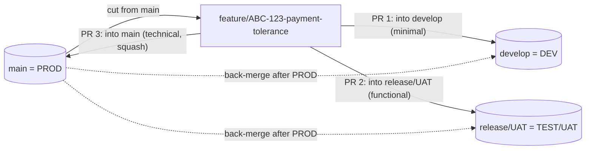

# Branching Strategy

This document defines the Git branching model for BC ALM template repositories. It is opinionated and designed specifically for Microsoft Dynamics 365 Business Central Per-Tenant Extensions (PTEs) where selective deployment is a core requirement.

---

## Core Principle: Selective Deployment

The biggest practical challenge in BC development is that not all features are ready to ship at the same time. You might have five features in development, but only three are approved by customers for the next wave. If you use a shared `develop` branch, all five features are merged together — you cannot ship three without shipping all five.

**This is why we do not use Git Flow.**

Instead, this strategy is based on:
- Feature branches cut directly from `main`
- Release branches composed selectively from specific feature merges
- `main` is always production-ready

> This is the **default** model (`template.config.json` → `values.branchingStrategy` =
> `feature-release-selective`). Projects that run one long-lived branch per BC environment can opt into
> the [environment-promotion alternative](#alternative-environment-promotion) instead.

---

## Why Not Git Flow?

Git Flow uses a permanent `develop` branch where all features merge. The problems with this for BC:

| Problem | Why it hurts BC teams |
|---|---|
| All features merge to `develop` together | Can't ship ABC-123 without ABC-124 if they're both merged |
| `develop` may be unstable | TEST deployments from `develop` reflect everything, not a curated selection |
| Long-lived `develop` branch causes conflicts | Multiple developers working on AL objects in the same module |
| Doesn't map to BC environment model | DEV/TEST/PROD doesn't map cleanly to feature/develop/main |

The alternative: each feature branch is independent, and release branches are **assembled** from the features you choose.

---

## Branch Types

### `main`

- **Purpose:** Production-ready code at all times
- **Represents:** PROD environment
- **Protection:** Branch protection rules — no direct pushes, PR required, at least 1 approver
- **What merges here:** Feature branches, after customer approval and docs are complete
- **Never:** Force push, bypass protection, commit directly

### `feature/ABC-{ID}-short-description`

- **Purpose:** Development of a single ADO work item
- **Cut from:** `main` (always fresh from production baseline)
- **Represents:** DEV environment (deployed to a developer sandbox for local testing)
- **Naming:** `feature/ABC-123-payment-tolerance`
- **Lifetime:** Created when spec is approved, deleted after merging to `main` post-PROD deployment
- **Who creates it:** Developer (Stage 4 of the workflow)

### `bugfix/ABC-{ID}-short-description`

- **Purpose:** Non-critical bug fix, follows same process as feature
- **Cut from:** `main`
- **Naming:** `bugfix/ABC-456-posting-date-error`

### `hotfix/ABC-{ID}-short-description`

- **Purpose:** Critical production bug requiring immediate fix
- **Cut from:** `main` (from the production tag if needed)
- **Naming:** `hotfix/ABC-789-vat-crash`
- **Fast track:** Can bypass some stages (spec may be minimal, documentation follows deployment)
- **Warning:** Hotfixes still require a PR and reviewer approval — speed does not mean skipping quality gates

### `release/YYYY-MM-wave-N`

- **Purpose:** Testing candidate for a specific deployment wave
- **Cut from:** `main` + merged with selected feature branches
- **Represents:** TEST environment
- **Naming:** `release/2025-06-wave-1`, `release/2025-06-wave-2`, `release/2025-07-wave-1`
- **What it contains:** Only the features approved for this wave
- **Never merges back to main** — each feature merges to main individually after PROD approval

---

## Branch Naming Conventions

| Type | Pattern | Example |
|---|---|---|
| Feature | `feature/ABC-{ID}-kebab-description` | `feature/ABC-123-payment-tolerance` |
| Bug fix | `bugfix/ABC-{ID}-kebab-description` | `bugfix/ABC-456-posting-date-error` |
| Hotfix | `hotfix/ABC-{ID}-kebab-description` | `hotfix/ABC-789-vat-crash` |
| Release | `release/YYYY-MM-wave-N` | `release/2025-06-wave-1` |

Rules:
- Always include the ADO ticket ID
- Use kebab-case (lowercase, hyphens)
- Keep descriptions short (3-5 words)
- Use the month of the planned deployment in release branches, not the development month

---

## Environment Mapping

```
DEV       →  feature/* branches        (developer sandbox)
TEST      →  release/* branches        (shared test environment)  
PROD      →  main branch               (production)
```

Deployments:
- `feature/ABC-123-payment-tolerance` → Developer's personal sandbox (via AL-Go or manual publish)
- `release/2025-06-wave-1` → TEST environment (via AL-Go pipeline or BC Admin Center API)
- `main` → PROD environment (via BC Admin Center API, after approval)

---

## Selective Deployment: How Release Branches Work

The key differentiator of this model. Say you have three completed features:
- `feature/ABC-100-new-payment-field` — customer approved ✅
- `feature/ABC-101-vat-report` — customer approved ✅
- `feature/ABC-102-inventory-module` — still in testing ❌

You want to deploy ABC-100 and ABC-101 to TEST, but NOT ABC-102.

### Composing `release/2025-06-wave-1`

```bash
# Start from main (production baseline)
git checkout main
git checkout -b release/2025-06-wave-1

# Merge only the approved features
git merge feature/ABC-100-new-payment-field --no-ff
git merge feature/ABC-101-vat-report --no-ff

# Do NOT merge feature/ABC-102 — it's not ready
```

The release branch now contains exactly ABC-100 + ABC-101, deployed to TEST for customer validation.

ABC-102 will be part of `release/2025-06-wave-2` or `release/2025-07-wave-1` when it's ready.

> The **BC Deploy agent** will guide you through this composition and verify that each included feature has an approved spec and merged PR.

---

## Feature Branch Lifetime

```
Spec approved → branch created (from main)
     │
     ▼
Development on feature branch
     │
     ▼
PR merged to main ──────────────────────────────┐
     │                                           │
     ▼                                           │
Branch merged into release/wave-N               │
     │                                           │
     ▼                                           │
Deployed to TEST                                 │
     │                                           │
     ▼                                           │
Customer approved + docs merged                  │
     │                                           │
     ▼                                           │
PROD deployed ◄──────────────────────────────────┘
     │
     ▼
Feature branch deleted (can be archived as tag if needed)
```

**Key:** The feature branch is kept alive until after PROD deployment because it may be needed for reference or re-testing. Delete it only after the full cycle completes.

---

## Optional: Integration Branch for Multi-Story Features

> **Optional pattern.** Use this only when a single Feature/Epic is broken into several child
> stories (see the `bc-breakdown-feature` skill) that must ship together as one unit. For an
> ordinary single-ticket change, stick with the plain `feature/ABC-{ID}-*` model above — do **not**
> add an integration branch.

When a Feature spans multiple stories, one long-lived branch integrates them before a single PR to
`main`, so the stories are reviewed and deployed as a coherent whole:

```
main
 └─ feature/ABC-100-payment-engine        ← integration branch (off main)
     ├─ story/ABC-101-tolerance-field      ← branched off integration, merged --no-ff back
     ├─ story/ABC-102-calculation          ← branched off integration (after 101 merged)
     └─ story/ABC-103-posting-hook         ← branched off integration (after 102 merged)
```

1. **Create the integration branch** off `main`: `feature/ABC-{FeatureID}-{short-name}`; link it to
   the parent Feature work item.
2. **Per child story (in order):**
   ```bash
   git switch feature/ABC-100-payment-engine
   git pull                                   # build on top of stories already merged
   git switch -c story/ABC-101-tolerance-field
   # …implement (bc-build-feature)…
   git switch feature/ABC-100-payment-engine
   git merge --no-ff story/ABC-101-tolerance-field -m "merge: ABC-101 into ABC-100"
   git branch -d story/ABC-101-tolerance-field
   ```
   Always `git pull` the integration branch before cutting the next story branch — a later story
   must build on all previously merged stories, not a stale copy.
3. **When every story is merged**, treat the integration branch exactly like a normal feature
   branch: run `bc-review-self`, open **one** PR to `main` (`bc-ship-pull-request`), then include it
   in a release wave (`bc-ship-release`).

Trade-off: an integration branch adds coordination overhead and delays feedback until the whole
Feature is done. Prefer shipping independent stories as separate feature branches whenever they do
**not** have to deploy together.

---

## Alternative: environment-promotion

> **Optional alternative.** Enable it with `template.config.json` → `values.branchingStrategy` =
> `environment-promotion`. The default stays `feature-release-selective` (everything above). The
> agents (`bc-pr`, `bc-deploy`, `bc-workflow`) read the setting and switch their procedure.

One **long-lived branch per BC environment**, and the **same feature branch** is promoted through
them by successive pull requests. It keeps selective deployment — every feature travels on its own
branch and only reaches an environment through its own PR — while giving each environment a branch
that always reflects what is deployed there.

| Branch | Environment (example) | Deployed on |
|---|---|---|
| `develop` | DEV — internal QA | merge of a PR into `develop` |
| `release/UAT` | TEST / UAT — customer acceptance | merge of a PR into `release/UAT` |
| `main` (`values.defaultBranch`) | PROD | merge of a PR into `main` |

Environment and branch names are **configurable**: environment names come from
`values.environments` (e.g. `["DEV", "TEST", "PROD"]`), the production branch from
`values.defaultBranch`. Record the branch → environment mapping in your pipeline (see the
`bc-cicd-pipeline` skill) and keep it in sync with this table.



### PR sequence

1. **Cut** `feature/ABC-{ID}-short-name` from `main` (as in the default model).
2. **PR → `develop`** — merges and deploys to DEV for internal QA.
3. **PR → `release/UAT`** — the **same** feature branch, after DEV QA passed; deploys to TEST/UAT
   for customer acceptance.
4. **PR → `main`** — the **same** feature branch, after customer sign-off and functional docs;
   **squash merge**; deploys to PROD.
5. **Back-merge** `main` into `release/UAT` and `develop` (see below), then delete the feature branch.

Each target gets a different PR description depth — Tier A minimal for `develop`, Tier B functional
(what to test) for `release/UAT`, Tier C technical for `main`. See *PR description tiers* in the
`bc-ship-pull-request` skill. Work-item states move with the PRs (Azure DevOps or GitHub Issues).

### Rules

- **Never merge `develop` or `release/UAT` into a feature branch.** It would drag unapproved work
  from other features into the PR to `main`. A feature branch only ever receives `main`
  (`git merge origin/main` when it needs a newer baseline).
- **Never promote branch-to-branch** (no PR `develop` → `release/UAT` or `release/UAT` → `main`).
  Only feature, bugfix and hotfix branches are PR'd into environment branches.
- **Conflicts with an environment branch** (e.g. `develop` contains another feature touching the
  same object): resolve them on a throw-away helper branch, never on the feature branch:
  ```bash
  git switch -c merge/ABC-123-into-develop feature/ABC-123-payment-tolerance
  git merge origin/develop          # resolve conflicts here
  git push -u origin merge/ABC-123-into-develop   # PR this helper into develop, then delete it
  ```
- **Protect all environment branches** (PR required, build check required), not only `main`.
- **Versioning:** several branches build in parallel, so a hand-bumped `app.json` version conflicts
  constantly. Pair this model with pipeline-managed versioning (`values.versioning` = `pipeline`,
  see `.github/skills/bc-cicd-pipeline/references/versioning.md`).

### Back-merge after every PROD release

`main` is squash-merged, so its history differs from the environment branches. Realign them right
after each PROD merge (and after each hotfix):

```bash
git fetch origin
git switch release/UAT
git merge origin/main      # fast-forwards when possible, otherwise creates a merge commit
git push origin release/UAT
git switch develop
git merge origin/main
git push origin develop
```

A merge commit is expected when the branch holds features not yet in PROD.
Push the back-merge directly or via an auto-approved PR, depending on your branch protection.
If `develop` accumulates abandoned features, re-create it from `main` (agree on it with the team
first — it rewrites a shared branch) and re-PR the still-active feature branches.

### Hotfix flow

1. Cut `hotfix/ABC-{ID}-short-name` from `main`.
2. Optional: PR it into `release/UAT` first when the fix must be verified on TEST/UAT.
3. PR it into `main` (squash), deploy to PROD.
4. Back-merge `main` into `release/UAT` and `develop` as above.

With pipeline-managed versioning, a hand-deployed emergency `.app` can use a revision between two
pipeline slots (e.g. `.11`) without colliding with the next pipeline build.

### When to choose which

| Choose **feature-release-selective** (default) when… | Choose **environment-promotion** when… |
|---|---|
| Releases ship in planned waves of selected features | Features go live individually, as soon as each is approved |
| One shared TEST environment per wave is enough | You run a permanent DEV and a permanent TEST/UAT environment that must always match a branch |
| You want the fewest long-lived branches | Your pipeline deploys per branch (push to `develop` → DEV, `release/UAT` → TEST, `main` → PROD) |
| Versions are bumped by hand in each PR | The pipeline computes versions (`values.versioning` = `pipeline`) |

Cost of the alternative: three PRs per feature, mandatory back-merges, and discipline around the
"never merge environment branches into a feature" rule.

---

## Branch Protection Rules for `main`

Configure these in GitHub → Settings → Branches → Branch protection rules for `main`:

| Rule | Setting |
|---|---|
| Require a pull request before merging | ✅ Enabled |
| Required approvals | 1 (minimum, recommend 2 for production repos) |
| Dismiss stale pull request approvals when new commits are pushed | ✅ Enabled |
| Require status checks to pass before merging | ✅ Enabled (AL-Go build pipeline) |
| Require branches to be up to date before merging | ✅ Enabled |
| Do not allow bypassing the above settings | ✅ Enabled |
| Restrict who can push to matching branches | Optional — restrict to senior devs |

---

## Relation to AL-Go for GitHub

[AL-Go for GitHub](https://github.com/microsoft/AL-Go) is Microsoft's recommended CI/CD framework for Business Central. This branching strategy is designed to work with AL-Go:

- AL-Go's default workflow triggers on PR to `main` — aligns with our PR-to-main model
- AL-Go build pipelines can be triggered on `release/*` branches for TEST deployments
- The `app.json` version bump requirement aligns with AL-Go's version management (with
  `values.versioning` = `pipeline` the build computes the version instead — see the
  `bc-cicd-pipeline` skill's `references/versioning.md`)
- AL-Go's branch naming conventions (`release/` prefix) are directly compatible

When using AL-Go, configure `AL-Go-Settings.json` to point deployments to the correct BC environments based on branch:
```json
{
  "environments": [
    { "name": "TEST", "branch": "release/*" },
    { "name": "PROD", "branch": "main" }
  ]
}
```

---

## Summary

Default model (`feature-release-selective`); for the optional alternative see
[environment-promotion](#alternative-environment-promotion).

| Decision | Choice | Reason |
|---|---|---|
| Feature branch base | `main` | Always start from PROD-stable baseline |
| Release branch method | Selective composition | Deploy only approved features |
| `develop` branch | Not used | Prevents selective deployment |
| `main` represents | PROD | Enforced by branch protection |
| `release/*` represents | TEST | One branch per deployment wave |
| Feature branch lifetime | Until post-PROD | Kept for reference/re-test |
