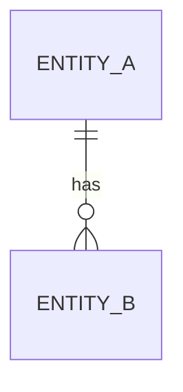

# <Area> — Specs

> Overview & navigation for one module / functional area. Copy this whole `_area/` folder to
> `specs/<Area>/` the first time the area gains a story (e.g. `specs/Finance/`). Free-form and any
> depth — `specs/Finance/Payments/` is fine too. Delete sections you don't need.

## Purpose

> What this module/area is about and which part of the business or app it covers.

## Stories

| ID | Type | Title | Status | Spec |
|---|---|---|---|---|
| <!-- 2117 --> | <!-- us --> | <!-- Country division modernization --> | <!-- In development --> | [link](us-2117-country-division-modernization/index.md) |
|  |  |  |  |  |

## Roadmap

Epics / features and sequencing for this area — see [roadmap.md](roadmap.md).

## Diagrams (optional)

> High-level, module-wide diagrams (ERD, process flow, decision tree). Story-specific diagrams live
> in each story's `plan.md`.

