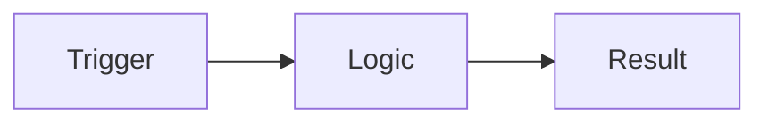

# <type>-<ID> — [Feature Title]

> Story overview & navigation. Copy this whole `_story/` folder to
> `specs/<Area>/<type>-<ID>-<slug>/` (e.g. `specs/Finance/Payments/us-123-payment-tolerance/`).

| | |
|---|---|
| **Status** | <!-- Draft / Spec review / In development / In test / Done --> |
| **Work item** | <!-- e.g. User Story 2117 --> — https://dev.azure.com/<!-- org -->/<!-- project -->/_workitems/edit/<!-- ID --> |
| **Area** | `specs/<Area>` |
| **Branch** | <!-- feature/<PREFIX>-<ID>-<slug> once development starts --> |

## Overview

> Two or three sentences: what this story delivers and why.

## Documents

- [Brief](brief.md) — business request, value, scope
- [Plan](plan.md) — technical design, affected AL objects, task breakdown
- [Acceptance Criteria](acceptance-criteria.md) — testable Given/When/Then
- [Change Log](change-log.md) — spec version history

## Diagram (optional)

> A quick flow of the story. Delete if not useful; keep detailed diagrams in `plan.md`.

