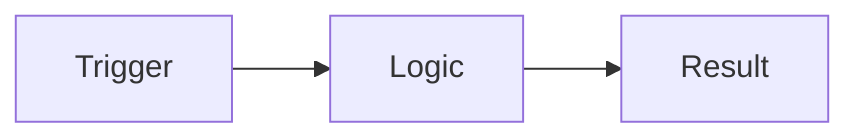

# <type>-<ID> — [Feature Title]

> Story overview & navigation. Copy this whole `_story/` folder to
> `specs/<Area>/<type>-<ID>-<slug>/` (e.g. `specs/Finance/Payments/us-123-payment-tolerance/`).

**Story:** **Index** · [Brief](brief.md) · [Plan](plan.md) · [Acceptance](acceptance-criteria.md) · [Change Log](change-log.md) · [↑ Area](../index.md)

| | |
|---|---|
| **Status** | <!-- Draft / Spec review / In development / In test / Done --> |
| **Work item** | <!-- e.g. User Story 2117 --> — https://dev.azure.com/<!-- org -->/<!-- project -->/_workitems/edit/<!-- ID --> |
| **Area** | `specs/<Area>` |
| **Branch** | <!-- feature/<PREFIX>-<ID>-<slug> once development starts --> |

## Overview

> Two or three sentences: what this story delivers and why.

## Documents

- [Brief](brief.md) — business request, value, scope
- [Plan](plan.md) — technical design, affected AL objects, task breakdown
- [Acceptance Criteria](acceptance-criteria.md) — testable Given/When/Then
- [Change Log](change-log.md) — spec version history
<!-- - [Estimation](estimation.md) — customer-facing work packages, hours and options (optional; add
     when an estimate is requested — see bc-spec-author references/estimation.md, and add
     "· [Estimation](estimation.md)" to every story nav bar) -->

<!--
BROKEN DOWN INTO TASKS? If this story is large or multi-part, split the technical detail into
numbered task sub-folders. Then this story keeps brief.md + roadmap.md + change-log.md (and this
index), plan.md / acceptance-criteria.md move DOWN into each task, and you list the tasks below
instead of the flat Documents list above. See the _task/ template and roadmap.md.

## Tasks

Sequencing & narrative: [Roadmap](roadmap.md)

| # | Task | Status | Approved | Spec |
|---|---|---|---|---|
| 01 | <!-- New country-division table --> | <!-- In development --> | <!-- yes --> | [01-new-country-division](01-new-country-division/plan.md) |
| 02 | <!-- Automatic bank-field filling --> | <!-- Planned --> | <!-- not yet --> | [02-automatic-bank-field-filling](02-automatic-bank-field-filling/plan.md) |
-->

## Diagram (optional)

> A quick flow of the story. Delete if not useful; keep detailed diagrams in `plan.md`.

