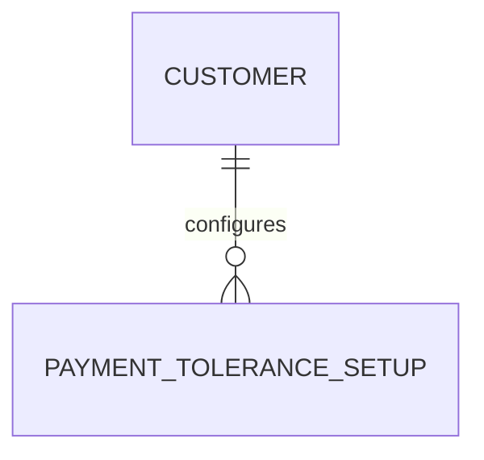

# Plan — [Feature Title]

> Technical specification for developers. Written after brief.md is approved.

**Story:** [Index](index.md) · [Brief](brief.md) · **Plan** · [Acceptance](acceptance-criteria.md) · [Change Log](change-log.md)

---

## Technical Summary

> One paragraph describing the technical approach at a high level.
> What pattern will be used? Extension table? Event subscriber? New codeunit?

*Example: "A new Payment Tolerance Setup table will store the tolerance percentage per customer group. A new Codeunit will calculate tolerance and post adjustment entries via an event subscriber on the payment posting codeunit. No base table modifications are required."*

---

## Affected AL Objects

> List every AL object involved in this implementation.
> Use your assigned object ID range. Check with your BC partner if unsure of your range.

| Object Type | Object ID | Object Name | Action | Notes |
|---|---|---|---|---|
| <!-- Table --> | <!-- 50100 --> | <!-- "ABC Setup Table" --> | <!-- Create / Modify --> | <!-- Notes --> |
| | | | | |
| | | | | |

**Object types:** Table, Table Extension, Page, Page Extension, Codeunit, Report, Report Extension, Query, Enum, Enum Extension, Interface, XMLport, PermissionSet

---

## New Objects to Create

> List only the new objects being created.

| Object Type | Object ID | Object Name | Purpose |
|---|---|---|---|
| | | | |

---

## Existing Objects to Modify

> List only existing BC or app objects being modified (must use extensions where possible).

| Object Type | Object ID | Object Name | What Changes |
|---|---|---|---|
| | | | |

> ⚠️ **Base table modifications are not allowed.** If you need to add fields to a base BC table, use a Table Extension instead. Flag any plan that requires direct base object modification for architect review.

---

## Technical Approach

> Describe the implementation pattern in detail.

### Data Model

*Describe any new tables, table extensions, or field additions.*

### Business Logic

*Describe the codeunit structure and key algorithms.*

### UI Changes

*Describe any page or page extension changes. Include field placement.*

### Events and Integration

*List any BC events you will subscribe to, or new events you will publish.*

---

## Dependencies

> What must exist or be configured before this feature can be implemented or tested?

- <!-- Dependency 1: e.g. "Payment Terms setup records must exist" -->
- <!-- Dependency 2: e.g. "Customer groups must be configured" -->

---

## Risks

> Technical risks or unknowns that could affect the implementation.

| Risk | Likelihood | Impact | Mitigation |
|---|---|---|---|
| <!-- Risk description --> | High/Med/Low | High/Med/Low | <!-- How to mitigate --> |

---

## BC Version Compatibility

- **Minimum BC Version:** <!-- e.g. BC 23 (2023 Wave 2) -->
- **Tested on:** <!-- e.g. BC 25 (2025 Wave 1) -->

---

## Performance Considerations

> Are there any queries, loops, reports, or batch processes that could affect performance?

- <!-- e.g. "The tolerance calculation loops over open customer ledger entries — add SetLoadFields() to minimise data transfer" -->

---

## Task Breakdown

> The ordered list BUILD executes. Keep it here in `plan.md` unless the story grows large enough to
> justify task sub-folders. Each task should touch only a few files and map back to an object above
> and/or an acceptance criterion.

**Status legend:** 🟪 Open · 🟦 In progress · 🟩 Ready for TEST · ✅ Done · 🔴 Blocked

Track progress by editing **only the Status cell** of a row — rows stay in place so diffs stay easy to follow.

| # | Status | Task |
|---|---|---|
| 1 | 🟪 Open | <!-- e.g. Create table 50100 "ABC Setup" with fields … --> |
| 2 | 🟪 Open | <!-- e.g. Add event subscriber in codeunit 50103 … --> |
| 3 | 🟪 Open | <!-- e.g. Add page extension 50101 to surface the field --> |
| 4 | 🟪 Open | <!-- e.g. Write tests for AC-01…AC-03 --> |

---

## Diagram (optional)

> Embed a mermaid diagram where it aids understanding — an ERD of new/extended tables, or the process
> flow. Delete this section if not needed. Keep module-wide diagrams in the area `index.md`/`roadmap.md`.

---

*Spec version: 1.0 — see [change-log.md](change-log.md) for history*
