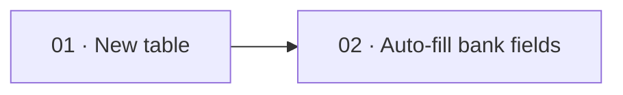

# [Feature Title] — Roadmap

> **Optional — only when this story is broken into tasks.** Sequences the task sub-folders: what
> gets built first, dependencies between tasks, and which tasks are approved now vs. future/parked.
> A small, single-deliverable story does not need this file — delete it and keep the flat layout.

**Story:** [Index](index.md) · [Brief](brief.md) · **Roadmap** · [Change Log](change-log.md) · [↑ Area](../index.md)

---

## Current status

> Keep this block current as work progresses — it's the first thing `bc-orchestrator` and `bc-pm`
> read to see where things stand without opening every task folder.

- **Current focus:** <!-- e.g. "Task 01 — New country-division table, in development" -->
- **Next action:** <!-- e.g. "Awaiting customer sign-off on task 02 scope" -->

## Tasks & sequencing

| # | Task | Depends on | Status | Approved | Spec |
|---|---|---|---|---|---|
| 01 | <!-- New country-division table + migration --> | — | <!-- In development --> | <!-- yes --> | [01-new-country-division](01-new-country-division/plan.md) |
| 02 | <!-- Automatic bank-field filling --> | 01 | <!-- Planned --> | <!-- not yet --> | [02-automatic-bank-field-filling](02-automatic-bank-field-filling/plan.md) |

## Notes

> Why this order, what is deferred and why (e.g. "task 02 is not approved yet — it will combine the
> new table with the standard field once the customer signs off"), and any cross-task decisions that
> affect more than one task.

## Diagram (optional)

