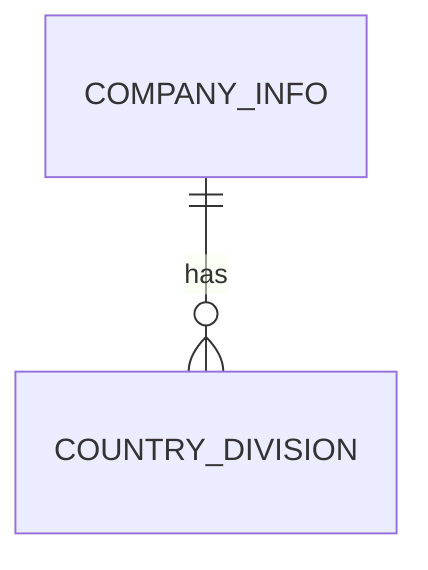

# Task NN — [Task Title]

> Technical specification for **one task** of a broken-down story. Copy the `_task/` folder to
> `<story>/NN-<task-slug>/` (e.g. `01-new-country-division/`). `NN` is a two-digit ordinal that fixes
> build order. Same depth as a story `plan.md`, but scoped to this task only.

**Task NN:** **Plan** · [Acceptance](acceptance-criteria.md) · [Change Log](change-log.md) · [↑ Story](../index.md)

---

## Technical Summary

> One paragraph: the technical approach for *this task*, and how it fits the story's other tasks.

---

## Affected AL Objects

> Every AL object this task creates or touches. Use your assigned object ID range.

| Object Type | Object ID | Object Name | Action | Notes |
|---|---|---|---|---|
| <!-- Table --> | <!-- 50100 --> | <!-- "ABC Country Division" --> | <!-- Create / Modify --> | <!-- Notes --> |
| | | | | |

**Object types:** Table, Table Extension, Page, Page Extension, Codeunit, Report, Report Extension, Query, Enum, Enum Extension, Interface, XMLport, PermissionSet

> ⚠️ **Base table modifications are not allowed** — use a Table Extension. Flag any plan that needs a
> direct base-object change for architect review.

---

## Technical Approach

> Implementation detail for this task: data model, business logic, UI changes, events/integration.
> For a **full** task spec follow the deep guidance in
> [`.github/skills/bc-spec-author/references/plan-authoring.md`](../../../.github/skills/bc-spec-author/references/plan-authoring.md).

---

## Dependencies

> What must exist before this task can be built or tested — including **other tasks in this story**
> (e.g. "depends on task 01's new table"). Keep the cross-task order in the story `roadmap.md`.

- <!-- Dependency 1 -->

---

## Risks

| Risk | Likelihood | Impact | Mitigation |
|---|---|---|---|
| <!-- Risk description --> | High/Med/Low | High/Med/Low | <!-- How to mitigate --> |

---

## BC Version Compatibility

- **Minimum BC Version:** <!-- e.g. BC 23 (2023 Wave 2) -->

---

## Task Breakdown

> The ordered list BUILD executes for this task.

**Status legend:** 🟪 Open · 🟦 In progress · 🟩 Ready for TEST · ✅ Done · 🔴 Blocked

Track progress by editing **only the Status cell** of a row — rows stay in place so diffs stay easy to follow.

| # | Status | Task |
|---|---|---|
| 1 | 🟪 Open | <!-- e.g. Create table 50100 "ABC Country Division" with fields … --> |
| 2 | 🟪 Open | <!-- e.g. Write tests for AC-01…AC-03 --> |

---

## Diagram (optional)

---

*Task spec version: 1.0 — see [change-log.md](change-log.md) (or the story change-log) for history*
